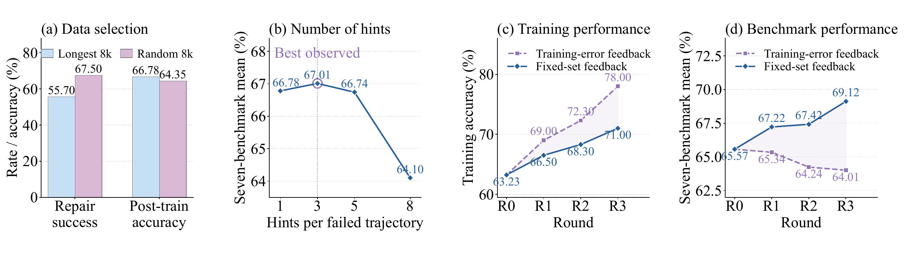

<div align="center">

<a href="https://www.zju.edu.cn/"></a>&nbsp;&nbsp;&nbsp;&nbsp;
<a href="https://www.antgroup.com/"></a>&nbsp;&nbsp;&nbsp;&nbsp;
<a href="https://www.shlab.org.cn/"></a>&nbsp;&nbsp;&nbsp;&nbsp;
<a href="https://www.sjtu.edu.cn/"></a>

# MedEvo: Medical Reasoning Evolution<br>through Knowledge Navigation

[Paper](https://pork-pay.github.io/MedEvo/assets/medevo.pdf) · [Project page](https://pork-pay.github.io/MedEvo/) · [GitHub](https://github.com/pork-pay/MedEvo)

[Xiaoliang Wang](https://openreview.net/profile?id=~Wang_Xiaoliang2)<sup>1,2*</sup>,
[Zhuo Chen](https://openreview.net/profile?id=~Zhuo_Chen3)<sup>2*</sup>,
[Chuanyang Zheng](https://openreview.net/profile?id=~Chuanyang_Zheng2)<sup>2</sup>,
[Quanbin Wang](https://openreview.net/profile?id=~Quanbin_Wang1)<sup>2</sup>,
[Jiangwei Lao](https://openreview.net/profile?id=~Jiangwei_Lao1)<sup>2</sup>,
[Yingao Liu](https://openreview.net/profile?id=~Yingao_Liu1)<sup>2</sup>,
[Jiajia Liu](https://openreview.net/profile?id=~Jiajia_Liu1)<sup>2</sup>,
[Jinming Cao](https://openreview.net/profile?id=~Jinming_Cao1)<sup>2</sup>,
[Honglin Lin](https://openreview.net/profile?id=~Honglin_Lin2)<sup>3,4</sup>,
[Zhihong Lu](https://openreview.net/profile?id=~Zhihong_Lu2)<sup>2</sup>,
[Hao Jin](https://openreview.net/profile?id=~Hao_Jin4)<sup>1</sup>,
[Jian Wang](https://openreview.net/profile?id=~Jian_Wang25)<sup>2</sup>,
[Lijun Wu](https://openreview.net/profile?id=~Lijun_Wu1)<sup>3,4†</sup>

<sup>1</sup>Zhejiang University · <sup>2</sup>Ant Group<br>
<sup>3</sup>Shanghai Artificial Intelligence Laboratory · <sup>4</sup>Shanghai Jiao Tong University

<sup>*</sup>Equal contribution · <sup>†</sup>Corresponding author

</div>

## What can a student learn from a failed answer?

A medical reasoning trace can contain useful observations and inferences before one error changes the conclusion. **MedEvo preserves the supported prefix, repairs the failed operation, and uses independent feedback to decide which failures to revisit.**

Knowledge Navigation operates at two levels:

1. **Within a trajectory:** an auditor without access to the reference answer diagnoses the first consequential error and supplies a minimal, answer-free hint. The same student keeps its valid prefix and regenerates the suffix. Correctness, prefix integrity, unsupported additions, and learnability are checked before a repair becomes a training target.
2. **Across rounds:** a fixed feedback set identifies remaining weaknesses and regressions by medical tags and error types. These guide fresh rollouts from the training pool, repair priorities, and updates to the supervision dataset.

Each round of supervised fine-tuning (SFT) starts from the original base model. The taxonomy and error codebook remain fixed; experience is carried through the evolving dataset. Feedback questions never enter training.

[](https://pork-pay.github.io/MedEvo/#method)

*The auditor receives only tags observable from the input; answer-derived labels are excluded. The project page explains the two decision loops before showing the complete pipeline.*

## Key observations

**Repair success and learning value are different objectives.** In a one-round Qwen3.5-9B comparison, the 8,000 questions with the longest failed traces have lower repair success than 8,000 randomly selected questions, but produce higher downstream accuracy:

| Selection | Repair success (%) | Mean accuracy after training (%) |
|:--|--:|--:|
| Longest traces | 55.70 | **66.78** |
| Random questions | **67.50** | 64.35 |

This comparison supports assessing the learning value of repairs. It does not isolate trajectory length from question difficulty.

**Preserving reasoning and diagnosing the error both matter.** Type-guided suffix continuation reaches 71.80% repair success and 67.22% mean accuracy in the first-round ablation. Hint-guided full rewriting reaches 57.80% and 63.20%, respectively.

**Training fit is insufficient feedback.** Training-error feedback reaches 78.00% training accuracy but 64.01% benchmark accuracy. Fixed-set feedback reaches 69.12% on the benchmarks. Independent assessment changes where subsequent repair effort is spent.

[](docs/assets/selection.png)

*Source: the paper's repair-design and learning-value experiments. All main experiments use one hint. In the longest-8k hint-count study, three hints yield 67.01% versus 66.78% for one hint; additional hints perform worse.*

## Results

Unweighted mean accuracy across **seven medical multimodal benchmarks**, using SFT:

| Backbone | Base (%) | MedEvo (%) | Absolute change | Rounds |
|:--|--:|--:|--:|--:|
| Qwen3.5-9B | 65.57 | **69.12** | +3.55 pp | 3 |
| Qwen3.5-35B | 67.91 | **73.04** | +5.13 pp | 3 |
| Qwen3.5-397B | 71.83 | **74.95** | +3.12 pp | 2 |

The benchmarks are PMC-VQA, VQA-RAD, SLAKE, PathVQA, OmniMedVQA, MedXpertQA-MM, and the medical subset of MMMU. “pp” denotes percentage points. The paper and [project page](https://pork-pay.github.io/MedEvo/#results) provide benchmark-level results and ablations.

The current study covers multiple-choice and short-answer medical image questions, uses a fixed knowledge structure, and relies on a strong proprietary auditor. Clinical use and transfer to other settings require further evaluation.

## Resources

- [Paper](https://pork-pay.github.io/MedEvo/assets/medevo.pdf): method, prompts, training configurations, experiments, and evaluation procedures.
- [Project page](https://pork-pay.github.io/MedEvo/): an illustrated explanation of the method and selected evidence.
- [Related project: ECG-RSI](https://pork-pay.github.io/ECG-RSI/): measurable ECG waveform supervision and feedback-guided intervention selection.

**This repository hosts the paper and project page. Implementation and training-data files are not released.** Underlying public datasets remain subject to their own licenses and access restrictions.

The static project page lives in `docs/` and needs no build step. To preview it locally:

```sh
python3 -m http.server 8000 --directory docs
```

Then open <http://localhost:8000/>.

## Citation

```bibtex
@misc{wang2026medevo,
  title  = {MedEvo: Medical Reasoning Evolution through Knowledge Navigation},
  author = {Wang, Xiaoliang and Chen, Zhuo and Zheng, Chuanyang and
            Wang, Quanbin and Lao, Jiangwei and Liu, Yingao and Liu, Jiajia and
            Cao, Jinming and Lin, Honglin and Lu, Zhihong and Jin, Hao and
            Wang, Jian and Wu, Lijun},
  year   = {2026},
  url    = {https://pork-pay.github.io/MedEvo/}
}
```
